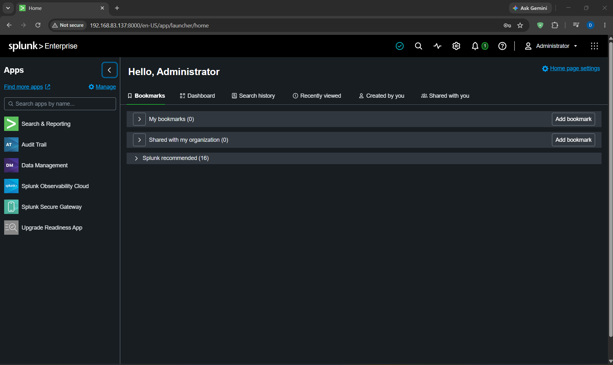
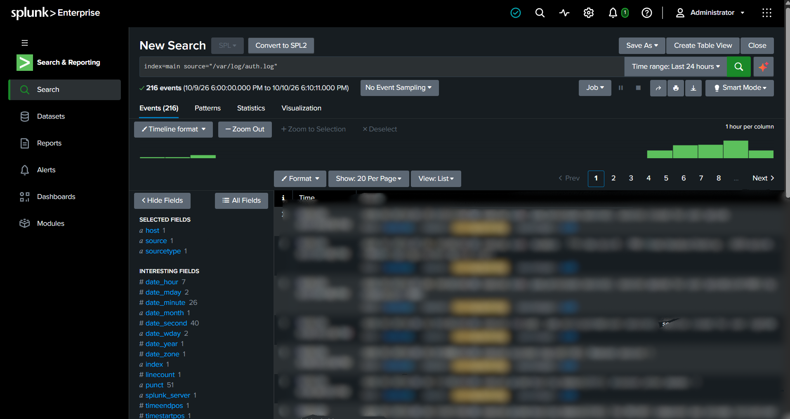
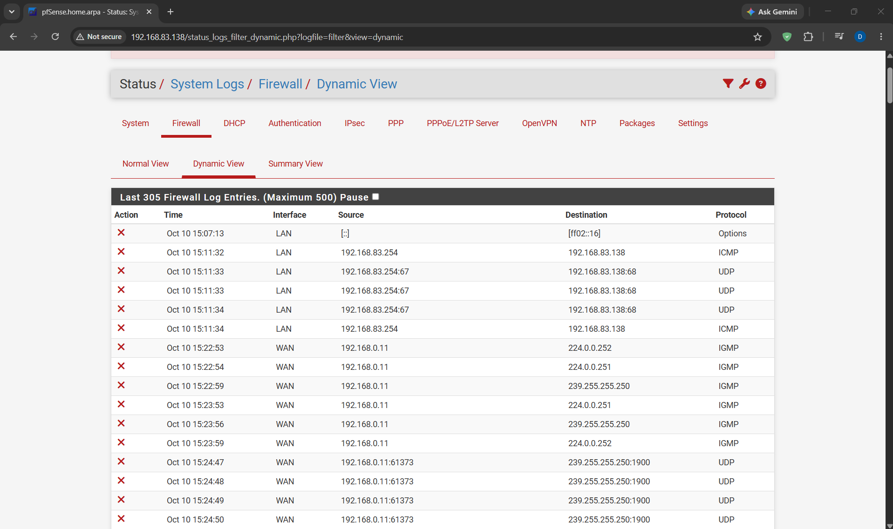
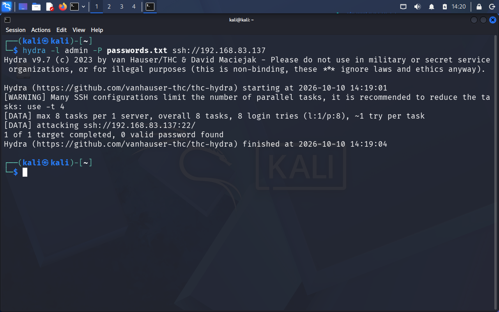
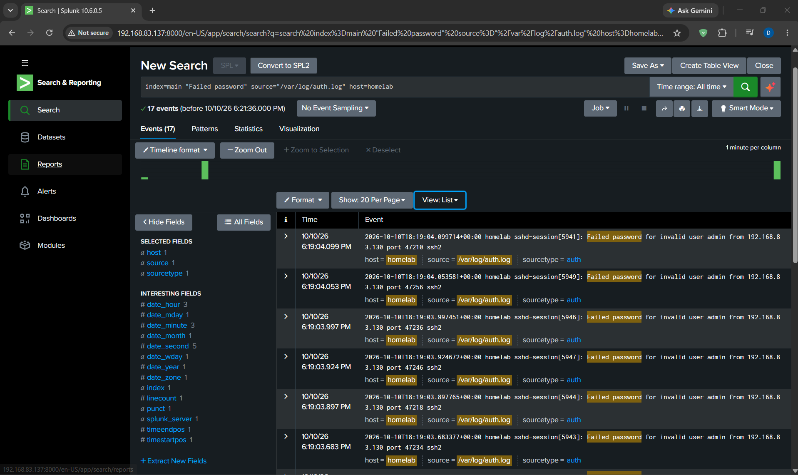
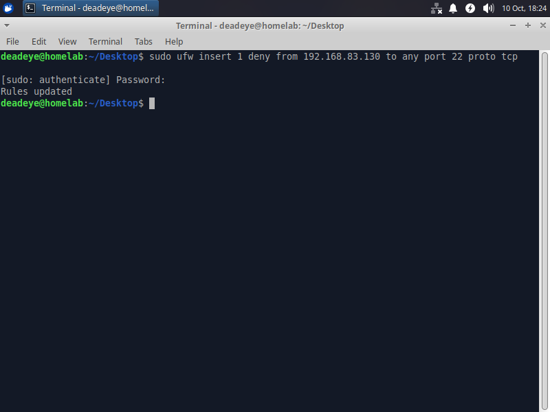
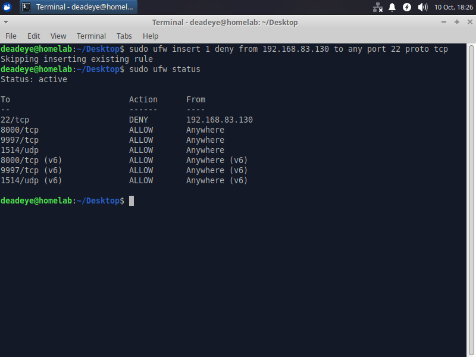

# Splunk SSH Brute-Force Detection and Incident Response

## Project Overview
This project demonstrates how to simulate an SSH brute-force attack in a controlled virtual lab, monitor security logs using Splunk SIEM, and respond by blocking the attacker's IP address.

# Tools and Technologies
- Splunk Enterprise — Security log monitoring and analysis
- Splunk Universal Forwarder** — Log collection and forwarding
- Ubuntu Server — SSH server and Splunk environment
- Kali Linux — Attack simulation using Hydra
- pfSense — Network security and log reporting
- Windows — Additional log collection using Universal Forwarder

# Project Workflow
1. Installed and configured Ubuntu Server.
2. Installed Splunk Enterprise and configured network access.
3. Installed and configured Splunk Universal Forwarders on Windows and Ubuntu.
4. Installed and configured pfSense, including WAN and LAN interfaces.
5. Configured SSH on the Ubuntu server.
6. Used Hydra with a password list to simulate SSH brute-force attempts in the lab.
7. Monitored and investigated relevant logs in Splunk.
8. Blocked the attacker's IP address as an incident response measure.

# Learning Outcomes
- SIEM deployment and log monitoring
- Log forwarding and collection
- SSH brute-force attack simulation
- Security event investigation
- Basic incident response and IP blocking

# Disclaimer
This project was performed in a controlled lab environment for educational purposes. Attack simulations should only be conducted on systems you own or have explicit permission to test.

# Network Architecture

The lab consists of multiple virtual machines and security components working together to simulate, monitor, and respond to SSH brute-force activity.

**Components:**
- Kali Linux: Generates controlled SSH brute-force test traffic using Hydra.
- Ubuntu Server: Hosts the SSH service and Splunk Enterprise.
- Windows: Sends selected system logs through Splunk Universal Forwarder.
- Ubuntu Universal Forwarder: Collects and forwards configured logs.
- pfSense: Provides network security controls and IP-blocking functionality.
- Splunk Enterprise: Receives and analyzes logs for security investigation.

Workflow: Attack Simulation → Log Collection → Splunk Investigation → IP Blocking → Response Validation

# Project Screenshots

# 1. Splunk Enterprise

# 2. SSH Log Ingestion

# 3. pfSense Configuration

# 4. Hydra Attack Simulation

# 5. Splunk Detection Results

# 6. IP Blocking Rule

# 7. Response Validation

